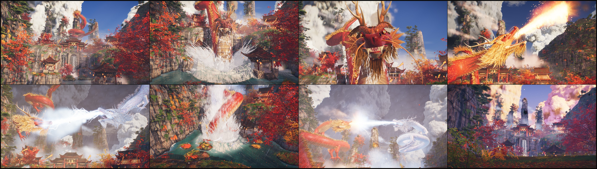

# 赤龍 · Crimson Loong

A 90-second dragon film that plays live in the browser from **one HTML file**.

A red loong lies coiled on a karst spire above a valley of red maples and vermilion halls. A white loong pours out of a storm cloud, the two fight across the sky, plunge into the lake, and rise together after a pearl. Then it loops.



## Pure three.js

- The only library is [three.js](https://threejs.org) r180, inlined into the page. No add-ons, no post-processing package, no physics engine, no audio library.
- No assets. There is no image, model, font, HDRI or sound file anywhere in the page: no `data:` URIs and no loaders in use. Every mesh, texture, shader and note is generated by code when the page loads.
- No network. The page requests nothing after it has been opened; it runs from disk (`file://`) as well as from a server.
- Sound is synthesised in a Web Worker and played through the Web Audio API.

## Watch it

Open `index.html` in a desktop browser with WebGL 2.

| Input | Action |
|---|---|
| Click, tap or `M` | Sound on |
| `Space` | Pause and resume (picture and sound together) |
| Pointer | Nudges the camera |

The page holds 60 frames a second at up to 3.7 megapixels on an Apple-silicon laptop GPU and lowers its internal resolution by itself when a frame runs long.

`v1.html` is the first version: 60 seconds, one dragon.

## How it is put together

Source lives in `src/` as plain scripts that are concatenated in name order. `python3 tools/build.py` inlines three.js and the source into `dist/crimson-loong.html`; `index.html` is a copy of that file.

| File | What it makes |
|---|---|
| `05_glsl.js` | Shared shader chunks: height fog, aerial haze, drifting cloud shadows, wind |
| `10_sdf.js`, `15_tex.js` | Signed-distance modelling kit; detail maps baked at load |
| `20_sky.js` | Ray-marched cumulus baked into drifting layers, the storm, the rift, rain |
| `30_rock.js` | Karst spires and cliffs from displaced parametric surfaces |
| `35_arch.js` | Gate, halls, pavilions; lanterns integrated as pendulums; cloth |
| `40_flora.js` | Maples, Huangshan pines, shrubs, grass, cliff plants |
| `58_dlook.js`, `60_dragon.js` | The dragons: scale shader, heads, manes, wetness; paths and poses |
| `66_wake.js` | How plants, dust and stones answer a passing body or a shock front |
| `68_water.js` | Lake with a planar mirror, current, falls, bow sheets and the splash |
| `70_fx.js` | Fire, frost, lightning, beam, blast, spray, shed water |
| `72_air.js` | Flowing mist, birds, leaves, smoke, fireflies, gust fronts |
| `80_post.js` | HDR target, ambient occlusion, bloom, grade, lens |
| `85_audio.js` | The score and every sound effect, synthesised |
| `88_film.js` | Beat sheet, camera, wind |
| `90_main.js` | Boot, lights, render loop, adaptive quality |

Everything on screen is a pure function of film time, so any frame can be rendered on its own and in any order. Effects that need memory (rings on the lake, torn leaves, swinging lanterns) read tables built once at load.

## Build and test

```bash
python3 tools/build.py
```

The other scripts in `tools/` are the test rig used while making the film: a headless-Chrome capture daemon (`capd.mjs`, `cap.py`) that renders exact frames to images and exports the score as a WAV, a frame-cost probe (`perf.py`), an image diff, and a workspace helper (`ws.py`). They need Node, Python 3 with Pillow, and a local Chrome.

## Credits

- [three.js](https://github.com/mrdoob/three.js), MIT licence. The licence text is in `vendor/LICENSE` and the copyright banner is kept in the built page.
- Made as an answer to scottstts' "Dragon's Nest", which used generated 3D assets; this one uses none.
